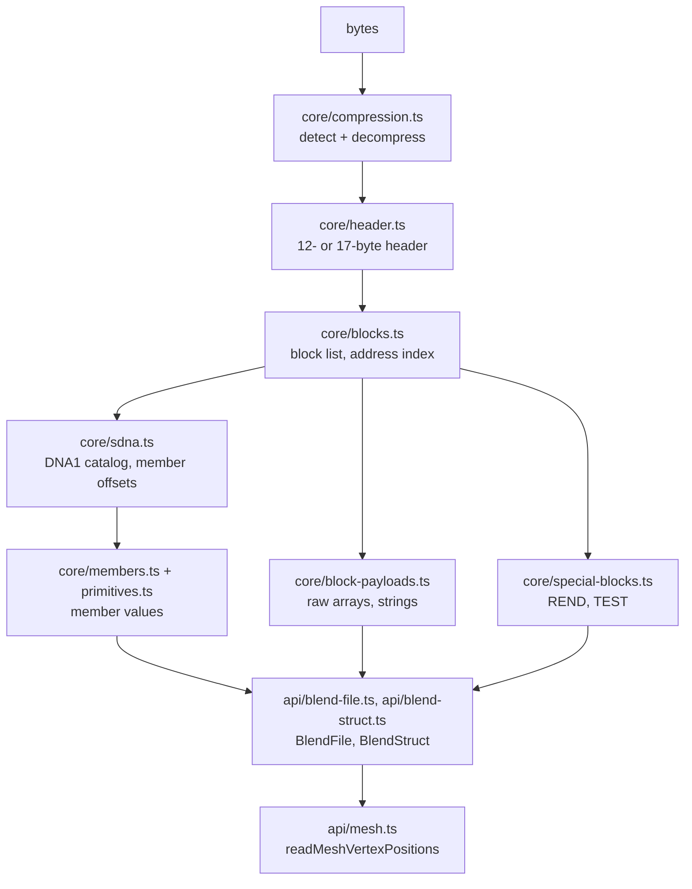

# Architecture: blendfile

## What it does

`blendfile` turns the bytes of a Blender `.blend` file into typed, navigable structs. It runs unchanged in browsers and Node.js: input is a `Uint8Array` or `ArrayBuffer`, and nothing inside touches the file system, the DOM or native code.

## Layers

- `src/core/` owns the format. Each module decodes one layer from bytes or a `ReadContext` (bytes, `DataView`, byte order, pointer size) and holds no state.
- `src/api/` owns navigation. `BlendFile` decodes header, blocks and SDNA once and indexes blocks by saved address. `BlendStruct` is a view (file, struct type, offset) that reads members on demand.
- The contract between the two is the exported core function signatures. `src/index.ts` exports both layers. `test/website-contract.test.ts` fails when the website's API reference misses an export.

- `vscode-extension/` is a client of `src/index.ts` like the website. `src/host/` registers a read-only custom editor and only moves bytes (`vscode.workspace.fs`, so remote and virtual file systems work). `src/webview/` parses and renders in the webview: the inspector (`preview-model.ts`) and the 3D view (`scene-model.ts` turns `readScene` output into triangles, normals and edges; `viewport.ts` draws them with three.js, which is bundled, so the webview needs no network). The model files are DOM-free and unit tested. Image textures follow the same split: the webview asks the host for an image by `Image.filepath` (`readImage`), the host resolves it next to the .blend file (`src/host/image-paths.ts`) and returns the bytes, and the webview decodes them (`texture-loader.ts`). The host sends a plain `Uint8Array`: VERIFIED in VS Code 1.141 that a Node `Buffer` from `readFile` reaches the webview unusable (the preview reported `NOT_BLEND`).

## Why this design

- **SDNA-driven instead of generated struct classes.** A generator over one Blender version's headers breaks on every other version, because struct layouts move: `Object.parent` sits at offset 320 in a 4.3 file and 496 in a 5.2 file. Decoding through the catalog each file carries reads any version with one code path.
- **Lazy views instead of decoding everything.** A file holds thousands of structs, mostly user-interface state. VERIFIED: the 5.2 fixture has 1,163 blocks, and 23 of its 28 datablocks are workspaces, screens or the window manager. Opening a file decodes only the header, block list and SDNA; members are read when asked for.
- **`bigint` addresses.** VERIFIED: Blender 5.2 writes 64-bit address values such as `0x24fbee8d08dd7f20`, which exceed `Number.MAX_SAFE_INTEGER`. A `number` would merge distinct pointers.
- **fzstd instead of `node:zlib`.** VERIFIED: Node 24's zstd decoder returns only the first frame of Blender's multi-frame zstd files (1,236 of 458,736 bytes). One pure-JS decoder also gives browsers and Node identical behavior.
- **Pointers resolve per datablock.** VERIFIED: Blender 5.2 reuses `DATA` addresses across datablocks, and Blender's reader resolves data pointers only among the blocks of the datablock being read. `createAddressResolver` does the same, and `BlendStruct` passes its own file offset so callers get the right block without knowing the rule. A file-wide map made one mesh read another mesh's faces.
- **World matrices are computed, not read.** Files store loc/rot/scale, deltas, rotation mode and `parentinv`, not `matrix_world`. `src/core/transforms.ts` follows `BKE_object_to_mat4` and `solve_parenting`; tests compare with Blender's matrices for every rotation mode.
- **Synchronous API.** fflate and fzstd decode synchronously, so `parseBlendFile` needs no `await`. The trade-off: a very large file blocks the calling thread; run it in a Worker in the browser if that matters.

## Operations

There is no service. The library is built with `make build` (pkgroll: ESM, CJS, `.d.mts`, `.d.cts` in `dist/`). `make e2e` packs the tarball, installs it into a clean project and runs it under Node as ESM and CJS against every fixture.

## Security and privacy

- Input is untrusted. Every length and offset read from the file is bounds-checked before use: block sizes against the file length, SDNA tables against the payload, thumbnail size against its block. A malformed file throws `BlendError` with code `CORRUPT` instead of reading out of range.
- 64-bit lengths above `Number.MAX_SAFE_INTEGER` are rejected.
- `readListBase` stops on address cycles.
- The library performs no network or file access, so file contents never leave the caller's process. The website's inspector parses files in the browser for the same reason. The VS Code host reads files a .blend file names only when they have an image extension (PNG, JPEG, WebP, BMP, GIF, OpenEXR) and are at most 256 MB, and passes their bytes only to the webview. The VS Code webview runs under a content security policy that allows only its own script (by nonce) and styles, with no network access.

The library sets no limit on the decompressed size, so a small zstd or gzip file can expand to a very large buffer. Callers that accept files from strangers should check the compressed size first.
