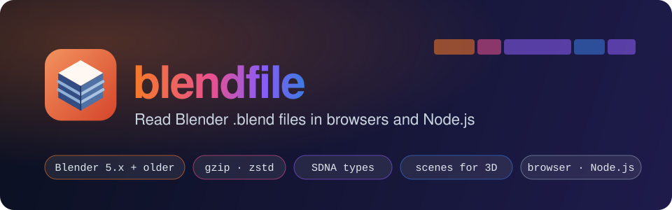
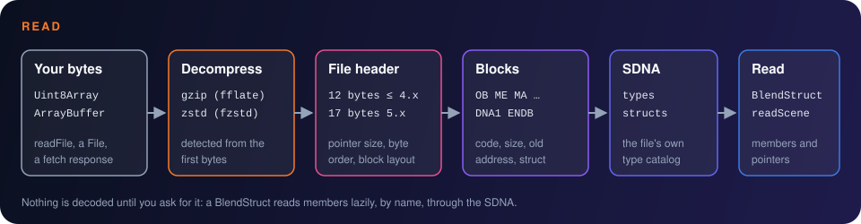

<p align="center">
  
</p>

<p align="center">
  <a href="https://mansi1.github.io/blendfile/"><b>Website</b></a> ·
  <a href="https://mansi1.github.io/blendfile/docs"><b>Docs</b></a> ·
  <a href="https://mansi1.github.io/blendfile/#playground"><b>Playground</b></a>: open your own .blend files in the browser
</p>

<p align="center">
  <a href="https://www.npmjs.com/package/blendfile"></a>
  
  
  
  
  
</p>

Reads Blender `.blend` files: the file header, every block, the file's own type catalog (SDNA) and the
structs it describes, following the specification in [`spec/`](spec/README.md):

| Part of the format | Read | Spec |
|---|---|---|
| 12-byte header of Blender up to 4.x, 17-byte header of Blender 5.0+ | ✓ | `spec/02-file-header.md` |
| gzip (Blender before 3.0) and multi-frame zstd (Blender 3.0+) compression | ✓ | `spec/03-compression.md` |
| All three block header layouts (`BHead4`, `SmallBHead8`, `LargeBHead8`) | ✓ | `spec/04-block-headers.md` |
| SDNA: names, types, sizes and structs stored in each file | ✓ | `spec/05-sdna.md` |
| Struct members, pointers, `ListBase` lists and arrays | ✓ | `spec/06-struct-data-and-pointers.md` |
| Render info and thumbnail (`REND`, `TEST`) | ✓ | `spec/07-special-blocks.md` |
| Datablocks (objects, meshes, materials, lights, cameras, images) | ✓ | `spec/08-datablocks.md` |
| Scenes for 3D viewers: world matrices, triangles, UV maps, materials | ✓ | `spec/09-scenes-and-geometry.md` |

- **Runs anywhere.** Input is a `Uint8Array` or an `ArrayBuffer`; there is no file system, DOM or
  native code inside, so the same code runs in browsers, Node.js and Bun. ESM and CommonJS builds ship
  with type declarations.
- **The file's own types.** Struct layouts come from the SDNA catalog each file carries, so members are
  read by name in any Blender version, without hard-coded offsets.
- **Lazy.** Nothing is decoded until you ask for it: a `BlendStruct` reads one member at a time.
- **Two small dependencies.** The pure-JS decompressors `fflate` (gzip) and `fzstd` (zstd).
- **Checked against Blender.** The tests read files written by Blender 4.3.0 and 5.2.2 and compare
  the values with what Blender itself reports for them (`input/*.truth.json`).

## How it works



A `.blend` file is a header followed by blocks. Each block holds one or more structs, and one block
(`DNA1`) describes every struct type of the file. The library reads the header and the block list once,
then decodes members lazily through that catalog and follows pointers by the old memory addresses the
blocks were saved with.

## Install

```sh
npm install blendfile       # or: bun add blendfile, pnpm add blendfile
```

It needs Node.js 18 or newer, or any current browser.

## Usage

### Node.js

```ts
import { readFile } from "node:fs/promises";
import { parseBlendFile } from "blendfile";

const blendFile = parseBlendFile(await readFile("scene.blend"));
blendFile.blenderVersion; // "5.2"
```

### Browser

```ts
import { parseBlendFile } from "blendfile";

input.addEventListener("change", async () => {
  const chosenFile = input.files?.[0];
  if (!chosenFile) return;
  const blendFile = parseBlendFile(await chosenFile.arrayBuffer());
  console.log(blendFile.listDatablocks().length);
});
```

### Reading data

```ts
import { readMeshVertexPositions } from "blendfile";

const cube = blendFile.findDatablock("OB", "Cube");
cube?.readMember("loc"); // [x, y, z]
const mesh = cube?.followPointer("data"); // Object → Mesh
if (mesh) readMeshVertexPositions(mesh); // Float32Array, xyz per vertex

blendFile.readRenderInfo(); // [{ sceneName, frameStart, frameEnd }]
blendFile.readThumbnail(); // { width, height, rgba } or undefined
```

Every failure throws `BlendError` with `code` `NOT_BLEND`, `UNSUPPORTED` or `CORRUPT`. The
[Docs](https://mansi1.github.io/blendfile/docs#api-reference) have the full API reference.

### API

| Export | Purpose |
|--------|---------|
| `parseBlendFile(bytes)` | decompress and open a file |
| `BlendFile` | blocks, SDNA, datablock lookup, pointer resolution, raw arrays and strings, render info, thumbnail |
| `BlendStruct` | lazy typed view of one struct: `readMember`, `readPointer`, `followPointer`, `followPointerToArray`, `readListBase`, `toJSON` |
| `readMeshVertexPositions(mesh)` | vertex positions across Blender 3.x, 4.x and 5.x mesh layouts |
| `readScene(file)` | the view layer's objects with type, world matrix, visibility and material slots; scene camera, world color, resolution |
| `readMeshGeometry(mesh)`, `triangulateMeshGeometry(geometry)` | faces, material slot and smooth flag per face; triangles for drawing |
| `listMeshUvMaps(mesh)`, `readMeshUvMap(mesh, name?)` | UV map names, the render UV map, u, v per face corner |
| `readMaterialAppearance`, `readLight`, `readCamera` | viewport and Principled BSDF values, image textures behind them, light power and shape, camera lens and sensor |
| core functions | `decompressFileBytes`, `decodeFileHeader`, `readBlockList`, `decodeSdna`, `readMemberValue` and the other readers of one format layer each |

## Supported files

| File | Status |
|------|--------|
| Blender 5.x (17-byte header, `LargeBHead8`) | tested with Blender 5.2.2 files |
| 64-bit little-endian files of Blender up to 4.x (`SmallBHead8`) | tested with Blender 4.3.0 files |
| zstd and gzip compression | tested |
| 32-bit (`BHead4`) and big-endian files | decoded per the specification; tested with synthetic files only |

## VS Code extension

**Blend File Preview** opens `.blend` and `.blend1` files in VS Code as a 3D view with materials, image
textures, lights and cameras, and as an inspector of every datablock and struct. It is built on this
library and runs offline. Download the `.vsix` from the
[Docs](https://mansi1.github.io/blendfile/docs#vscode-extension); [`vscode-extension/`](vscode-extension/README.md)
has the details.

## Development

| Command | Does |
|---------|------|
| `make setup` | install locked dependencies and Playwright's Chromium |
| `make test` | unit and integration tests |
| `make lint` | oxlint and TypeScript checks |
| `make build` | library build into `dist/` |
| `make website` | static website into `website/dist/` |
| `make dev` | website dev server on port 3000 |
| `make start` / `make stop` | serve the built website on port 4173 |
| `make e2e` | pack, install into a clean project, run under Node ESM and CJS; Playwright over every website page and the extension webview; the `.vsix` in real VS Code |
| `make vscode-package` | VS Code extension into `vscode-extension/blendfile-preview.vsix` |
| `make vscode-e2e` | install the `.vsix` into a throwaway VS Code profile and open every fixture |
| `make vscode-publish` | run `vscode-e2e`, then publish the `.vsix` to the VS Code Marketplace (`VSCE_PAT`) and Open VSX (`OVSX_PAT`) |
| `make verify` | lint, test, coverage, e2e |

### Repository

| Path | Content |
|------|---------|
| `src/core/` | pure functions, one per format layer |
| `src/api/` | `BlendFile`, `BlendStruct`, `readMeshVertexPositions` |
| `spec/` | the format specification (Markdown) |
| `test/` | tests against Blender-written fixtures and synthetic files |
| `input/` | fixtures written by Blender 4.3.0 and 5.2.2, with Blender's own values in `*.truth.json` |
| `tools/make_fixtures.py` | regenerates the fixtures: `Blender -b --factory-startup --python tools/make_fixtures.py -- input v43` |
| `tools/render_social_image.ts` | renders the website's link preview image: `bun tools/render_social_image.ts` |
| `tools/make_scene_fixture.py` | regenerates the scene fixtures for the 3D view: `… --python tools/make_scene_fixture.py -- input scene_v43` |
| `website/` | defuss-ssg site: the overview with the playground, the docs with the whole specification |
| `vscode-extension/` | VS Code custom editor for `.blend` and `.blend1` files: a 3D view of the scene and an inspector; see its README |
| `e2e/` | packed-library consumer test, Playwright tests of the website and the extension's webview |

The website ([mansi1.github.io/blendfile](https://mansi1.github.io/blendfile/), deployed from `main` by
[`.github/workflows/pages.yml`](.github/workflows/pages.yml)) lives in [`website/`](website/README.md): an
overview with the playground, the docs with the whole specification, and a `404.html` for GitHub Pages. It is
built with [defuss](https://github.com/kyr0/defuss) (defuss-ssg) and
[defuss-shadcn](https://github.com/kyr0/defuss-shadcn).

## License

[MIT](LICENSE) © 2026 Michael Mannseicher.

## Author

This repo is brought to you by:

<table>
  <tbody>
    <tr>
      <td align="center">
        
        <br/>
        <a href="https://github.com/mansi1">Michael Mannseicher</a>
        <br/>
        <a href="https://michael.mannseicher.com">Website</a>
      </td>
    </tr>
  </tbody>
</table>
