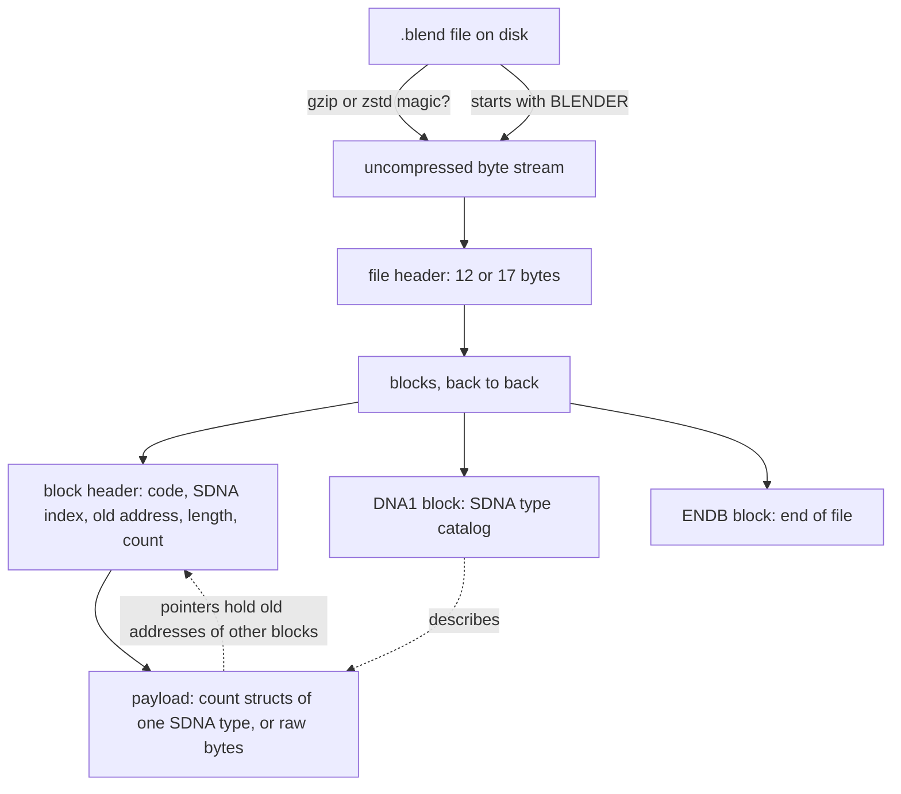

# 01 File structure

A `.blend` file is a memory dump. Blender writes its in-memory C structs to disk almost unchanged and adds two things a reader needs: block headers that say where each struct came from, and a catalog (SDNA) that describes the layout of every struct type.

## Layers

1. **Compression** ([03](03-compression.md)). The whole file can be gzip or zstd compressed. Readers decompress first; nothing inside the stream refers to compression.
2. **File header** ([02](02-file-header.md)). Says the pointer size, byte order, Blender file version, and which block header layout follows.
3. **Blocks** ([04](04-block-headers.md)). A sequence of block header + payload pairs, read until the `ENDB` block. Blocks have no alignment padding between them.
4. **SDNA** ([05](05-sdna.md)). The `DNA1` block lists every struct name, member name, type and size the writing Blender knew. It lets a reader decode files from any version without built-in struct definitions.
5. **Struct data** ([06](06-struct-data-and-pointers.md)). Each block payload is an array of structs whose type is given by the block's SDNA index, or untyped bytes when the index is 0.
6. **Datablocks** ([08](08-datablocks.md)). Blocks whose code is a 2-letter ID code (`OB`, `ME`, `SC` ...) start a datablock: an object, mesh, scene and so on. The `DATA` blocks that follow hold the memory it owns.

## Block order in practice

VERIFIED: in the fixtures the order is `REND`, optional `TEST`, `GLOB`, then the window manager (`WM`) and the remaining datablocks, each followed by its `DATA` blocks, then `DNA1`, then `ENDB`.

The `DNA1` block comes near the end, so a reader collects block headers first and decodes structs after it has parsed `DNA1`. The order is a writer convention: readers must not depend on it beyond "`ENDB` is last".

## Version differences in one table

| Property | Blender ≤ 4.x (format 0) | Blender 5.0+ (format 1) |
|----------|--------------------------|-------------------------|
| File header | 12 bytes | 17 bytes |
| Block header | 20 bytes (`BHead4`) or 24 bytes (`SmallBHead8`) | 32 bytes (`LargeBHead8`) |
| Maximum block payload | 2 GiB (signed 32-bit length) | 2^63 − 1 bytes (signed 64-bit length) |
| Byte order | little or big endian | little endian only |
| Pointer size | 4 or 8 bytes | 8 bytes only |

VERIFIED: Blender 4.5 reads format 1; Blender 5.0 refuses big-endian files (`readfile.cc`, "support for these files has been removed in Blender 5.0").
