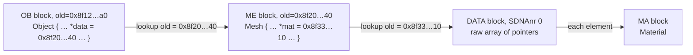

# 06 Struct data and pointers

## Typed blocks

A block with `SDNAnr` > 0 holds `nr` consecutive structs of that type, each `TLEN[type]` bytes. Member *m* of element *i* is at

```
payload offset + i × struct size + member offset
```

Values use the file's byte order. Inline struct members (for example `ID id` inside `Object`, or `RenderData r` inside `Scene`) are read with the same rule, recursively.

## Pointers and saved addresses

A pointer member holds the address the target had in memory when the file was written. The target block's header stores the same value in `old`. To follow a pointer, look up the block whose `old` equals the pointer value. 0 is null.



Pointers point at the start of a block, matched exactly on `old`.

### Addresses are unique per datablock, not per file

Blender's reader does not keep one file-wide address table. `DATA` blocks belong to the non-`DATA` block in front of them: a datablock such as `ME`, or `GLOB`, `USER` and the like. Blender reads one datablock and its `DATA` blocks, resolves the data pointers among those blocks only, then clears the table before the next datablock (`read_data_into_datamap` and `oldnewmap_clear` in `readfile.cc`). Pointers to other datablocks, such as `Object.data` or `Mesh.mat[i]`, resolve through a separate file-wide table of datablock addresses.

So a reader has to resolve a pointer in this order:

1. the `DATA` blocks of the datablock the pointer was read from;
2. the datablock blocks of the whole file;
3. (for old files only) any block with that address.

VERIFIED: in `input/scene_v52.blend` (Blender 5.2), eight addresses are shared by several `DATA` blocks. The `AttributeArray` blocks of the meshes `BoxMesh` and `BallMesh` have the same `old` values. A file-wide table hands `BoxMesh` the 480 corners of `BallMesh` instead of its own 24. Blender 4.3 files contain no such collisions except `REND` and `GLOB`, which nothing points at.

VERIFIED: Blender 4.3 writes real heap addresses (`0x8f12787a0`). Blender 5.2 writes values that look like hashes and use all 64 bits (`0x24fbee8d08dd7f20`). Readers must treat addresses as opaque 64-bit keys. In JavaScript that means `bigint`, because a `number` loses precision above 2^53.

## Pointer targets by kind

| Member | Target block | How to read it |
|--------|--------------|----------------|
| `Object *parent` | typed block (`SDNAnr` = Object) | struct |
| `CustomDataLayer *layers` | typed block with `nr` elements | array of structs |
| `Material **mat` | `DATA` block, `SDNAnr` 0 | array of pointers, `len / pointer size` elements |
| `char *name` | `DATA` block, `SDNAnr` 0 | NUL-terminated string |
| `void *data` | `DATA` block, often `SDNAnr` 0 | depends on context, e.g. `float[3]` per vertex |

For raw blocks the struct or element type comes from the member that points at it, not from the block.

## ListBase

`ListBase { void *first, *last; }` is Blender's doubly linked list. Every element struct starts with `*next` and `*prev`. To iterate, follow `first` and then each element's `next` until 0. Since `first` and `last` are `void *`, the element type comes from each target block's `SDNAnr`.

## Arrays

C arrays are row-major: `float obmat[4][4]` stores row 0 first. A `char name[64]` array is a fixed buffer holding a NUL-terminated UTF-8 string. Arrays of `char` arrays (`char names[4][64]`) hold one string per row.

## Byte order

Big-endian files (format 0 with `V`) store every integer and float in big-endian order: block headers, the `DNA1` tables and all struct data. Block codes are still readable as characters in order. Blender 5.0+ refuses such files; the library reads them by passing the byte order to every read.

UNKNOWN: no real big-endian or 32-bit file is in the fixtures. These paths are tested only with synthetic files built from this specification (`test/synthetic.test.ts`).
