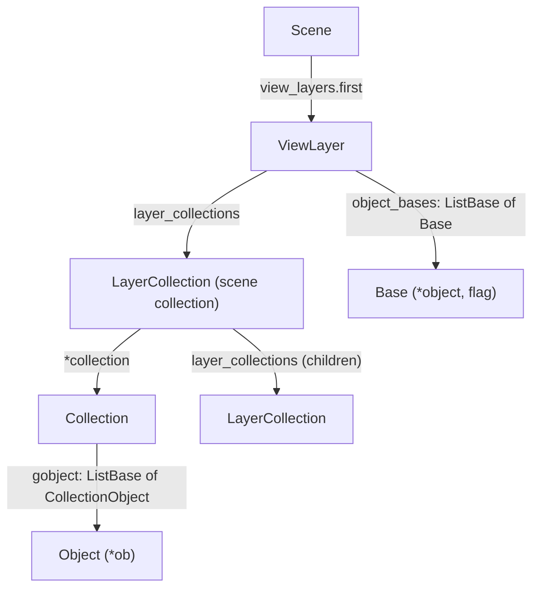

# 09 Scenes and geometry

What a viewer needs to draw a scene the way Blender's viewport does, and where each value lives in the file. A file stores the scene as the user built it, not as Blender displays it. World matrices, modifier results and evaluated normals are recomputed when Blender loads the file and are not saved.

All tables are VERIFIED against `input/scene_v43.blend` and `input/scene_v52.blend`. `tools/make_scene_fixture.py` wrote those files, and the values Blender reported for them are in `scene_*.truth.json`. The library code is `src/api/scene.ts`, `src/api/mesh.ts` and `src/core/transforms.ts`.

## Which objects a scene shows



The objects of a view layer are the objects of all collections in its layer collection tree, minus excluded collections. Blender hides an object in the viewport when any of these is set:

| Flag | Member | Value |
|------|--------|-------|
| Collection excluded from the view layer (objects are not in the layer at all) | `LayerCollection.flag` | `1 << 4` (`LAYER_COLLECTION_EXCLUDE`) |
| Collection hidden in the view layer (eye icon) | `LayerCollection.flag` | `1 << 7` (`LAYER_COLLECTION_HIDE`) |
| Collection disabled in viewports | `Collection.flag` | `1 << 0` (`COLLECTION_HIDE_VIEWPORT`) |
| Object disabled in viewports | `Object.restrictflag` (stored name of `visibility_flag`) | `1 << 0` (`OB_HIDE_VIEWPORT`) |
| Object hidden in the view layer (eye icon, `hide_set`) | `Base.flag` | `1 << 8` (`BASE_HIDDEN`) |

An object in several collections is visible when any of them shows it.

## Object types

`Object.type`: 0 empty, 1 mesh, 2 legacy curve, 3 surface, 4 text, 5 metaball, 10 light, 11 camera, 12 speaker, 13 light probe, 22 lattice, 25 armature, 26 legacy grease pencil, 27 curves, 28 point cloud, 29 volume, 30 grease pencil (`DNA_object_types.h`). `Object.*data` points at the type's datablock (`Mesh`, `Lamp`, `Camera` ...); empties have none.

Curves, text, metaballs, volumes and point clouds become geometry only during evaluation, which is not saved. A reader without Blender's evaluation code can show their transforms but not their shape.

## Object transforms

Blender stores the transform parts, not the matrix. The object-to-world matrix is computed from them, as in `BKE_object_to_mat4` and `solve_parenting` (`blenkernel/intern/object.cc`):

```
local  = translate(loc + dloc) · rotation · scale(size · dscale)
world  = parent.world · parentinv · local          (no parent: world = local)
```

| Part | Members | Notes |
|------|---------|-------|
| Location | `loc[3]`, `dloc[3]` (delta) | added |
| Scale | `size[3]` (stored name of `scale`), `dscale[3]` | multiplied per axis |
| Rotation mode | `rotmode` | 0 quaternion, 1 XYZ, 2 XZY, 3 YXZ, 4 YZX, 5 ZXY, 6 ZYX, −1 axis-angle |
| Euler | `rot[3]`, `drot[3]` | radians; the first axis of the order applies first: XYZ is Rz · Ry · Rx |
| Quaternion | `quat[4]`, `dquat[4]` | w, x, y, z; normalized before use |
| Axis-angle | `rotAxis[3]`, `rotAngle`, `drotAxis[3]`, `drotAngle` | |
| Delta rotation | `drot` / `dquat` / `drotAxis`+`drotAngle` | rotation = delta · main |
| Parent | `*parent`, `parentinv[4][4]`, `partype` | `parentinv` is the inverse parent matrix taken when parenting |

Matrices in the file (`float[4][4]`) are column-major: `m[3]` is the translation column.

VERIFIED: the computed matrices match Blender's `matrix_world` to within 1.5e-7 for all six Euler orders, quaternion and axis-angle rotation, delta transforms and a parented object, in both files. A Workbench render of the scene camera in Blender 5.2 places objects at the same pixels as the library's camera (within 3 px at 800 × 600).

Parent types other than object parenting (`partype` bone, vertex, three vertices) need the parent's evaluated pose or mesh. The library treats them as object parenting. Constraints, drivers and animation are not evaluated either: the saved values are the ones at the frame the file was saved on.

UNKNOWN: Blender skips evaluating objects in collections hidden in the viewport. For such an object, `matrix_world` in the Python API stays stale (identity in the fixture), so the truth files cannot confirm its matrix. The tests check its location instead.

## Mesh faces

Since Blender 3.6, a mesh stores faces as offsets into a corner array:

| Data | Blender 4.x | Blender 5.x |
|------|-------------|-------------|
| Face offsets | `Mesh.*poly_offset_indices` → `int[totpoly + 1]` | same |
| Corner → vertex | `ldata` layer `".corner_vert"` (type 11, `MIntProperty[totloop]`) | `attribute_storage` attribute `".corner_vert"` → `AttributeArray` → `int[totloop]` |
| Material slot per face | `pdata` layer `"material_index"` (`int`), absent when all faces use slot 0 | attribute `"material_index"` |
| Flat shading | `pdata` layer `"sharp_face"` (`bool` as 1 byte), absent when all faces are smooth | attribute `"sharp_face"`, often a single value (`AttributeSingle`) |

Face `i` uses corners `offsets[i]` up to `offsets[i + 1]`. Faces can be n-gons and can be concave (the fixture's star has 10 corners), so drawing them needs a triangulation that handles concave polygons. A face with n corners gives n − 2 triangles.

Blender 5.x writes an attribute that has the same value for every element as an `AttributeSingle` holding one value (`Attribute.storage_type` 1) instead of an `AttributeArray`.

Files from before 3.6 store `MPoly` (`loopstart`, `totloop`, `mat_nr`, `flag` with `1 << 0` = smooth) and `MLoop` (`v`, `e`) arrays. UNKNOWN: no such file is in the fixtures.

Modifiers are listed in `Object.modifiers`. Each element is its own struct type (`SubsurfModifierData` ...), which starts with a `ModifierData` member named `modifier` (name in `modifier.name`). Their results are not saved: the file holds the mesh before modifiers.

## Materials

| Value | Where |
|-------|-------|
| Material per slot | `Object.matbits[i]` (`char *`) chooses: 1 = `Object.**mat[i]`, 0 = the data's `**mat[i]` (`Mesh.mat`). The slot count is the larger `totcol` |
| Viewport display color (solid mode) | `Material.r`, `.g`, `.b`, `.a` (linear) |
| Viewport metallic and roughness | `Material.metallic`, `.roughness` |
| Node tree | `Material.*nodetree` → `bNodeTree.nodes` (ListBase of `bNode`), `links` (ListBase of `bNodeLink`) |
| Principled BSDF inputs | the `bNode` with `idname == "ShaderNodeBsdfPrincipled"`, its `inputs` (ListBase of `bNodeSocket`) by `identifier` (`"Base Color"`, `"Metallic"`, `"Roughness"`, `"Alpha"`, `"Emission Color"`, `"Emission Strength"`) |
| A socket's constant value | `bNodeSocket.*default_value` → `bNodeSocketValueRGBA.value[4]` or `bNodeSocketValueFloat.value` |

A socket is driven by another node when a `bNodeLink.tosock` points at it. Its `default_value` is then not what renders; a reader without a node evaluator can only fall back to the viewport color.

VERIFIED: Blender 5.2 gives every new material a node tree with a Principled BSDF, including materials that Blender 4.3 left without nodes.

## Lights

The struct is stored as `Lamp`; its runtime name is `Light`.

| Value | Member | Notes |
|-------|--------|-------|
| Type | `type` | 0 point, 1 sun, 2 spot, 4 area |
| Color | `r`, `g`, `b` | linear |
| Power | `energy_new` | Watts; W/m² for sun. **The member named `energy` in the file is a deprecated value** (`DNA_STRUCT_RENAME_MEMBER(Light, energy_new, energy)`) |
| Exposure | `exposure` (5.x only) | power × 2^exposure |
| Spot cone | `spotsize` (full angle, radians), `spotblend` | |
| Area size | `area_size`, `area_sizey`, `area_shape` (0 square, 1 rectangle, 4 disk, 5 ellipse) | |
| Radius | `radius` | soft shadow size |

A light shines along its object's local −Z axis.

VERIFIED: reading `energy` gives 509.3 for an area light whose power is 400 W in Blender 4.3; `energy_new` gives 400.

## Cameras

| Value | Member |
|-------|--------|
| Projection | `type`: 0 perspective, 1 orthographic, 2 panoramic |
| Focal length | `lens` (mm) |
| Sensor | `sensor_x`, `sensor_y` (mm), `sensor_fit` (0 auto, 1 horizontal, 2 vertical) |
| Orthographic size | `ortho_scale` |
| Clipping | `clipsta`, `clipend` |
| Shift | `shiftx`, `shifty` |
| Scene camera | `Scene.*camera` (an `Object`) |
| Render size | `Scene.r.xsch`, `Scene.r.ysch` |

A camera looks along its local −Z axis with +Y up. With auto sensor fit, `sensor_x` spans the larger image side.

## World

`Scene.*world` → `World.horr`, `horg`, `horb` is the world color (linear). Rendered views use it as the background and as ambient light. A world with nodes renders from its `Background` node instead.
