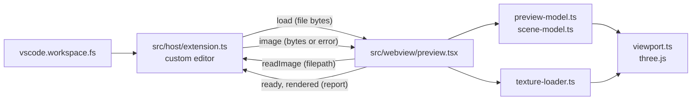

# Architecture: vscode-extension

## What it does

Blend File Preview is a read-only custom editor for `.blend` and `.blend1` files. It shows a 3D view of the scene, the thumbnail, the datablocks and a struct browser. It is a client of the `blendfile` library in `src/`, like the website, and never writes to the file.

## How it works

- `src/messages.ts` is the contract between the two sides: `load` and `image` go to the webview, `ready`, `rendered` and `readImage` go to the host.
- The host only moves bytes. It reads through `vscode.workspace.fs`, so remote and virtual file systems work, and the same bundle (`dist/extension.cjs`) is the `main` and the `browser` entry.
- `src/webview/preview-app.tsx` is the whole preview UI behind one function, `createPreviewApp(root, { readImageFile, onReport })`. `preview.tsx` is the VS Code entry: it connects that function to the host messages. The website's inspector mounts the same function in a shadow root and answers `readImageFile` from files the user chose. The preview therefore looks elements up inside its root, never in `document`, and handlers read the element that fired from `event.composedPath()` (`dom-events.ts`), because defuss dispatches from the document, where events from a shadow root are retargeted to its host.
- The webview parses the file with the library and renders it. `preview-model.ts` builds the inspector and `scene-model.ts` turns `readScene` output into triangles, normals, edges, UV channels and materials. Both are DOM-free and unit tested in `test/`. `viewport.ts` draws them with three.js, which is bundled into `media/preview.js`.
- Image textures follow the same split. The webview asks for an image by the path stored in the material's Image datablock. `src/host/image-paths.ts` resolves it next to the .blend file (Blender's `//` paths, absolute paths, then `<folder>/<name>` and `<folder>/textures/<name>`), and the host returns the bytes. Packed images come from the .blend file itself and need no request. `texture-loader.ts` decodes PNG, JPEG, WebP, BMP and GIF with `createImageBitmap` and OpenEXR with three.js's EXRLoader, and scales every image to at most 2048 px on its longest side.
- After each render the webview posts a `rendered` report (view mode, counts, texture totals and failures). The integration suite in `test-electron/` waits for these reports instead of reading pixels.

## Why this design

- Parsing in the webview keeps the host small and lets one host bundle run in desktop VS Code and vscode.dev. The host sends a plain `Uint8Array`, because a Node `Buffer` from `readFile` reached the webview unusable in VS Code 1.141 (the preview reported `NOT_BLEND`).
- Textures are scaled to 2048 px and stored as 8-bit RGBA because asset files ship 4K maps. Full-size float textures for a few of them would use several hundred MB of GPU memory.

## Operations

- **Deployment:** `make vscode-package` builds `blendfile-preview.vsix`. `make vscode-publish` runs `make vscode-e2e` first and then publishes that file to the VS Code Marketplace and Open VSX, with the tokens from `VSCE_PAT` and `OVSX_PAT`.
- **Complexity and resources:** decoding runs on the webview's main thread. For the 4K sample `sparse_grass_4k.blend`, JPEG decoding took about 0.4 s, a roughness EXR about 2.2 s and a normal EXR about 7 s, mostly in EXRLoader's DWAA decompression. Textures load one after another, and the status line shows progress.
- **Reliability:** a missing or unreadable image does not stop the preview. The material keeps its base values, and the status line names the missing image with the reason in its tooltip.

## Security and privacy

- **Inputs from outside:** the .blend file and the image paths written in it. The host reads a named file only when it has an image extension (PNG, JPEG, WebP, BMP, GIF, OpenEXR) and is at most 256 MB, and passes the bytes only to the webview.
- **Webview:** it runs under a content security policy with `default-src 'none'` that allows only its own script (by nonce) and styles. It makes no network requests, and its resources load only from `media/`.
- **Privacy:** no personal data is processed. File contents never leave the VS Code process, and the extension sends no telemetry.
