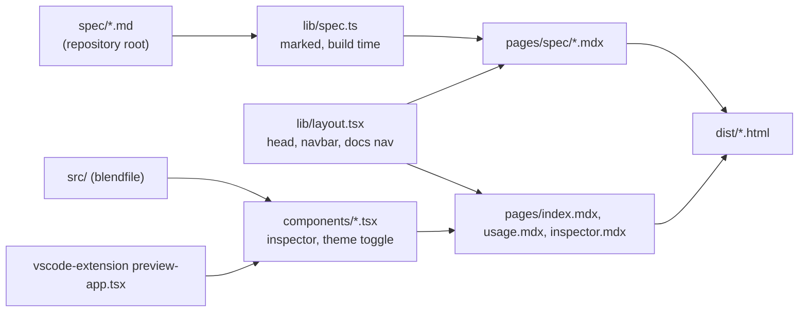

# Architecture: website

## What it does

The website documents the `.blend` format and the `blendfile` library, and offers an inspector that runs the VS Code extension's preview of `.blend` files in the browser. It is a static site built with defuss-ssg (Vite 8 underneath), defuss JSX and defuss-shadcn components.

## Structure

- `lib/` runs only at build time; defuss-ssg does not hydrate it. `components/` is rendered at build time and hydrated in the browser.
- `spec/` is the single source of the format documentation. Each `pages/spec/<slug>.mdx` contains one `<SpecPage slug>` element, and `lib/spec.ts` renders the Markdown with marked. It rewrites links between spec files to site routes and turns Mermaid fences into the defuss-shadcn Mermaid figure. `test/website-contract.test.ts` keeps the page list equal to `spec/*.md`.
- `components/inspector.tsx` is the VS Code extension's preview: it imports `createPreviewApp` from `blendfile-preview`, an alias for `vscode-extension/src/webview/preview-app.tsx`, which imports the library from `src/index.ts`. The preview renders into a shadow root with its own stylesheet (`vscode-extension/media/preview.css`, copied to `assets/vendor/blend-preview.css` by the vendor plugin). The extension's CSS styles plain elements (`body`, `h1`, `table`) and class names that defuss-shadcn also uses (`.badge`, `.button`), so without the shadow root the two stylesheets would restyle each other. `site.css` maps the site theme onto the `--vscode-*` variables the preview reads, on the host element; custom properties inherit into the shadow root. Image files chosen with the .blend file answer the preview's texture requests by file name, and the textured sample fetches its images next to the sample.
- The `website/package.json` scripts run defuss-ssg in `website/` (`bun run build`, `bun run dev`; the Makefile calls them). defuss-ssg builds from a copy in `.ssg-temp/`, so relative imports out of `website/` would break. Code outside the folder is imported by name instead: `viteConfig.resolve.alias` in `config.ts` maps `blendfile` to `src/index.ts` and `blendfile-preview` to the extension's preview, and `tsconfig.json` has the same `paths`. Build-time code reads `input/` and `spec/` through `REPOSITORY_ROOT` in `lib/site.ts`.
- `config.ts` follows the audio-tag website's config:
  - `vendor` (`pre`) writes `assets/vendor/ui.css` (defuss-shadcn's core CSS plus each component in `lib/ui.ts`), `core.min.js` and one script per component that has one, and copies the theme, the preview stylesheet, three sample files with the textured sample's images, and the packed `.vsix` (all gitignored). Loading only the 13 components the pages use replaces `all.min.css` and `all.min.js` (1.3 MB) with about 165 KB. The source map comments are removed, because the maps are not copied and the dev server logged an error for each one.
  - `html-fix` (`page-html`) prepends the doctype, which defuss-ssg 0.7.5 does not write, and makes URLs page-relative. Pages write root-absolute URLs, and the plugin rewrites them per page depth (`/usage` becomes `./usage` on the overview and `../usage` on spec pages), so one build works at any base path. `data-hydrate-src` and `data-hydrate-runtime` become `./X`, because the hydration runtime resolves them from `components/`. The `?v=Date.now()` cache-bust in the hydration scripts is removed. `404.html` keeps absolute `/blendfile/` URLs, because GitHub Pages serves it at any depth.
  - `github-pages` removes `.html` from every in-site `<a href>` (`lib/pretty-links.ts`). `make dev` skips page-html plugins, so a Vite `transformIndexHtml` plugin does the same there.
  - `not-found-dev` answers a missing page in `make dev` with the 404 page and status 404, as GitHub Pages does (`lib/dev-routes.ts`, tested in `test/dev-routes.test.ts`).
  - `drop-config` (`post`) deletes `dist/config.js`, which defuss-ssg 0.7.5 writes into the output.
  - `code-highlight` (`page-html`) colors every fenced code block with Shiki (`lib/highlight.ts`, theme `tokyo-night`) while the page is written, so the browser loads no highlighter. The hydrated code examples get their tokens from `lib/examples.ts` as props instead, because hydration re-renders them.
- `lib/layout.tsx` writes Open Graph and Twitter tags with absolute URLs (`lib/site.ts`), which link previews in WhatsApp, Slack or X need. The preview image `assets/social-preview.jpg` (1200 × 630, about 95 KB) is rendered from an HTML card by `tools/render_social_image.ts`.
- The brand colors (Blender orange and blue with pink and violet between them) are tokens and gradients at the end of `site.css`. They are unlayered, so they override the defuss-shadcn component styles, which sit in cascade layers.

## Why this design

- Rendering `spec/*.md` at build time, rather than copying the text into MDX, keeps one source of truth. MDX would also choke on the braces and angle brackets in byte-layout tables.
- The inspector reuses the extension's preview instead of a second implementation, so the 3D view, textures and struct browser behave the same in VS Code and on the site, and one set of e2e tests covers both. The preview holds its state in a closure per mounted root and re-renders parts with `$(ref).update(...)`, the defuss pattern for explicit updates.

## Operations

`make website` builds into `website/dist/`. `make start` serves it at http://localhost:4173/blendfile/ with `vite preview`, the path GitHub Pages uses. `preview.config.ts` sets `appType: "mpa"`: Vite then serves `/usage` from `usage.html` and a missing page as a 404, whereas its default single-page mode, like `defuss-ssg serve`, answered any unknown path with the overview, which would hide a broken link. `make dev` runs the dev server on port 3000. `make e2e` runs Playwright over every built page under `/blendfile/`.

`.github/workflows/pages.yml` builds the site on every push to `main` and deploys it to GitHub Pages under `/blendfile/`.

Mermaid diagrams load Mermaid 12.0.0 from jsDelivr at view time; this is the defuss-shadcn Mermaid component's default. It is one of the components in `lib/ui.ts`.

## Security and privacy

Files opened in the inspector stay in the browser: the .blend file and any image files chosen with it are read with `File.arrayBuffer()` and parsed locally, and the page makes no request with their content. Mermaid is the only third-party script, rendered with `securityLevel: "strict"` by the component.
