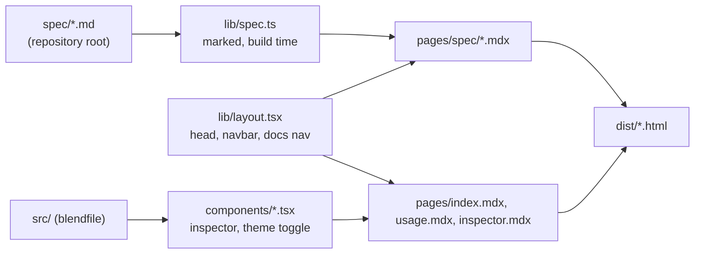

# Architecture: website

## What it does

The website documents the `.blend` format and the `blendfile` library, and offers an inspector that runs the VS Code extension's preview of `.blend` files in the browser. It is a static site built with defuss-ssg (Vite 8 underneath), defuss JSX and defuss-shadcn components.

## Structure

- `lib/` runs only at build time; defuss-ssg does not hydrate it. `components/` is rendered at build time and hydrated in the browser.
- `spec/` is the single source of the format documentation. Each `pages/spec/<slug>.mdx` contains one `<SpecPage slug>` element, and `lib/spec.ts` renders the Markdown with marked. It rewrites links between spec files to site routes and turns Mermaid fences into the defuss-shadcn Mermaid figure. `test/website-contract.test.ts` keeps the page list equal to `spec/*.md`.
- `components/inspector.tsx` is the VS Code extension's preview: it imports `createPreviewApp` from `../../vscode-extension/src/webview/preview-app.tsx`, which imports the library from `src/index.ts`. The preview renders into a shadow root with its own stylesheet (`vscode-extension/media/preview.css`, copied to `assets/vendor/blend-preview.css` by `make website-assets`). The extension's CSS styles plain elements (`body`, `h1`, `table`) and class names that defuss-shadcn also uses (`.badge`, `.button`), so without the shadow root the two stylesheets would restyle each other. `site.css` maps the site theme onto the `--vscode-*` variables the preview reads, on the host element; custom properties inherit into the shadow root. Image files chosen with the .blend file answer the preview's texture requests by file name, and the textured sample fetches its images next to the sample.
- These relative imports work because defuss-ssg copies the site into `.ssg-temp/` in the working directory, and that relative path resolves both from `website/components/` (dev) and from `.ssg-temp/components/` (build) only when the commands run from the repository root. The Makefile and the `website/package.json` scripts do that.
- `config.ts` adds a `page-html` plugin that prepends `<!doctype html>`, since defuss renders from `<html>` down.
- `make website-assets` copies defuss-shadcn's `core.min.css`, `all.min.css` and `all.min.js`, the preview stylesheet, three sample files with the textured sample's images, and the packed `.vsix` into `assets/` (all gitignored).

## Why this design

- Rendering `spec/*.md` at build time, rather than copying the text into MDX, keeps one source of truth. MDX would also choke on the braces and angle brackets in byte-layout tables.
- The inspector reuses the extension's preview instead of a second implementation, so the 3D view, textures and struct browser behave the same in VS Code and on the site, and one set of e2e tests covers both. The preview holds its state in a closure per mounted root and re-renders parts with `$(ref).update(...)`, the defuss pattern for explicit updates.

## Operations

`make website` builds into `website/dist/`. `make start` serves it on port 4173 (`defuss-ssg serve`), `make dev` runs the dev server on port 3000. `make e2e` runs Playwright over every built page.

`.github/workflows/pages.yml` builds the site on every push to `main` and deploys it to GitHub Pages. Project pages are served under `/blendfile/`, while the pages use root-absolute URLs. The `site-base` plugin in `config.ts` therefore prefixes `href`, `src`, the defuss-ssg hydration attributes and the hydration scripts' runtime import with `SITE_BASE`. The workflow sets it from `actions/configure-pages`. The inspector's sample URLs are relative instead, because only the root-level inspector page uses them. VERIFIED: a build with `SITE_BASE=/blendfile/`, served under `/blendfile/`, loaded every page and the inspector sample in Chromium with no failed requests.

Mermaid diagrams load Mermaid 12.0.0 from jsDelivr at view time; this is the defuss-shadcn Mermaid component's default.

## Security and privacy

Files opened in the inspector stay in the browser: the .blend file and any image files chosen with it are read with `File.arrayBuffer()` and parsed locally, and the page makes no request with their content. Mermaid is the only third-party script, rendered with `securityLevel: "strict"` by the component.
